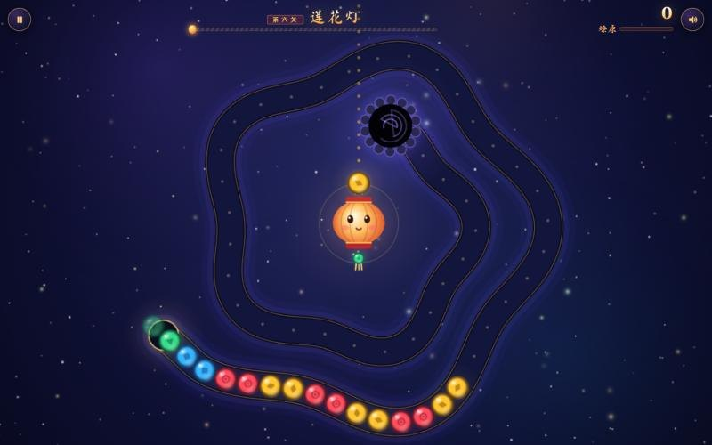
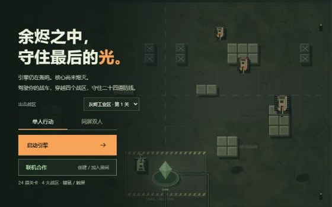

<div align="center">

# 翼程游戏厅

**打开就能玩的原创网页游戏**

### [▶ 进入游戏厅](https://hbycrj.com/games/)

作者：[清河县翼程软件开发](https://hbycrj.com) · [hbycrj.com](https://hbycrj.com)

</div>

## 收录的游戏

| 游戏 | 类型 | 在线试玩 | 源码 |
|---|---|---|---|
| **萤灯连珠** | 轨道珠链三消 · 17 关 + 无尽模式 | [hbycrj.com/games/zuma](https://hbycrj.com/games/zuma/) | [flyzss/game_zuma](https://github.com/flyzss/game_zuma) |
| **余烬防线 EMBERLINE** | 装甲防守 · 24 关 · 联机合作 | [hbycrj.com/games/tank](https://hbycrj.com/games/tank/) | [flyzss/game_tank](https://github.com/flyzss/game_tank) |

<a href="https://hbycrj.com/games/zuma/"></a>
<a href="https://hbycrj.com/games/tank/"></a>

## 这个仓库

游戏厅的入口页：纯静态 HTML + CSS，没有脚本、没有外部依赖。

```
index.html               页面（游戏卡片直接写在 HTML 里，利于搜索引擎收录）
style.css                样式
covers/                  游戏封面（16:10）
fonts/                   子集化的站酷小薇体（标题用）
tools/subset-fonts.py    字体子集化脚本
tools/fontsrc/           原始字体（仅开发用，不需要部署）
```

### 部署

把 `index.html`、`style.css`、`covers/`、`fonts/` 放到网站的 `/games/` 目录，每个游戏放在它的子目录里（如 `/games/zuma/`、`/games/tank/`）。卡片里的链接是相对路径，部署到其他目录也能用。

### 新增一款游戏

1. 在 `covers/` 放一张 16:10 的封面图。
2. 复制 `index.html` 里的一个 `<article class="game">`，改名称、介绍、标签、链接；`--accent` 是这款游戏的主题色。交替加上 `flip` 类可以让封面左右错开。
3. 更新首屏的游戏数量和 `<script type="application/ld+json">` 里的游戏列表。
4. 页面里出现了新的中文字时，重新生成字体：

```bash
pip install fonttools
python tools/subset-fonts.py
```

## 作者

由 **[清河县翼程软件开发](https://hbycrj.com)** 开发并开源。我们承接小程序、App、网站与企业软件定制开发，详见官网 [hbycrj.com](https://hbycrj.com)。

## 许可

本项目源码以 [MIT License](LICENSE) 开源。标题字体 [站酷小薇体](https://fonts.google.com/specimen/ZCOOL+XiaoWei) 使用 SIL Open Font License 1.1，见 `fonts/OFL-zcoolxiaowei.txt`。
